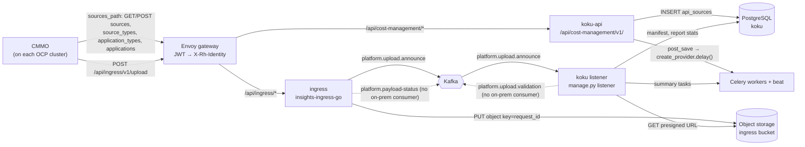

# On-prem contract: Koku, Sources, and Ingress

Status: **Reference / pre-design.** This document records the contract that
exists today between Koku, "Sources", and Ingress in the on-prem deployment
managed by this operator. It is the input for replacing `insights-ingress-go`
and Kafka with a small Go component, following the same approach as
[rbac-mini](https://github.com/martinpovolny/rbac-mini) replacing
`insights-rbac`.

Scope:

- **In scope:** the on-prem (`ONPREM=True`) path only, for OpenShift sources
  reported by the Cost Management Metrics Operator (CMMO).
- **Out of scope:** SaaS (console.redhat.com), cloud providers, and ROS.
  ROS does not need to ship with the replacement. Its dependencies on Sources
  and Kafka are listed in [ROS dependencies](#ros-dependencies-out-of-scope)
  so the gap is visible, not so the new component covers them.

Sources read for this document (fetched 2026-11-26):

| Repo | Ref |
|------|-----|
| koku-service-operator | `main` @ `474d937` |
| project-koku/koku | `origin/main` |
| RedHatInsights/insights-ingress-go | `master` @ `0f1966f` |
| project-koku/koku-metrics-operator (CMMO) | `main` @ `45a62834` |
| RedHatInsights/ros-ocp-backend | `main` (shallow clone) |

## Summary

1. **There is no separate Sources service on-prem.** `sources-api-go` is
   not deployed. Koku-api serves a sources-api-compatible subset under
   `/api/cost-management/v1/` and writes directly to the `api_sources` table
   (`Sources` model). CMMO is pointed at it with
   `sources_path: /api/cost-management/v1/`.
2. **Ingress** is `insights-ingress-go`. It accepts the CMMO upload, stores
   the tarball in object storage, and announces it on Kafka topic
   `platform.upload.announce`.
3. **Koku's listener** (`manage.py listener`) is the only consumer of
   `platform.upload.announce`. It downloads the payload from a presigned
   URL, resolves `cluster_id` to a Source and Provider, and processes the
   reports.
4. **Kafka carries exactly one in-scope flow:** Ingress → Koku
   (`platform.upload.announce`). Two other topics are produced in that flow
   but have no consumer on-prem. The remaining topics are ROS-only.

Removing Kafka for the Cost Management path therefore means replacing one
producer (Ingress) and one consumer (the Koku listener). The Sources API can
stay in koku-api as it is.

## Current topology



The operator builds these pieces in:

- `internal/resources/ingress.go` — ingress Deployment/Service and the
  `INGRESS_*` environment.
- `internal/resources/koku.go` — the listener Deployment
  (`LISTENER_TOPIC=platform.upload.announce`).
- `internal/resources/envoy.go` — routes `/api/ingress/` and
  `/api/cost-management/` and builds `X-Rh-Identity` from the Keycloak JWT.
  There is no `/api/sources/` route.

## Identity (shared by every contract below)

All external calls pass through Envoy. Envoy validates the Keycloak JWT and
replaces `X-Rh-Identity` with a base64 JSON document built by its Lua filter
(`internal/resources/envoy.go`, `build_xrhid_json`):

```json
{
  "org_id": "<jwt org_id>",
  "identity": {
    "org_id": "<jwt org_id>",
    "account_number": "<jwt account_number>",
    "type": "User",
    "user": {"username": "...", "email": "...", "is_org_admin": true}
  },
  "entitlements": {"cost_management": {"is_entitled": true}}
}
```

Requests without `org_id` or `account_number` claims are rejected with
`401` at the gateway. Backends trust the header and do no JWT validation of
their own.

A replacement component behind Envoy receives the same header and needs only
`identity.org_id` and `identity.account_number` from it. It must also keep the
original base64 string, because Koku stores it (see `b64_identity` below).

## Contract A — CMMO → Sources API (served by koku-api)

CMMO's source handler (`koku-metrics-operator/internal/sources/handler.go`)
calls these endpoints relative to `api_url + sources_path`. On-prem,
`sources_path` is `/api/cost-management/v1/`, so Envoy sends them to koku-api.

| Call | Purpose in CMMO | Koku implementation |
|------|-----------------|---------------------|
| `GET source_types?filter[name]=openshift` | Look up the OpenShift type ID | `SourceTypesView`. Static list. On-prem returns only `{"id":"1","name":"openshift"}`. |
| `GET sources?filter[source_type_id]=1&filter[source_ref]=<cluster_id>&filter[name]=<name>` | Check whether this cluster is registered | `SourcesViewSet` list. `source_ref` filters on `authentication.credentials.cluster_id`. Scoped to the caller's `org_id`. |
| `POST sources` `{"name","source_type_id":"1","source_ref":"<cluster_id>"}` | Register the cluster | `AdminSourcesSerializer.create`. See side effects below. |
| `GET application_types?filter[name]=/insights/platform/cost-management` | Look up the cost app type ID | `ApplicationTypesView`. Static `{"id":"0", ...}`. |
| `POST applications` `{"source_id","application_type_id":"0"}` | Attach cost management to the source | `ApplicationsView.post`. Validates that the source exists and returns `201`. Nothing is stored. |

Response envelope for list calls: `{"meta": {"count": N}, "data": [...]}`.
CMMO reads `id`, `name`, `source_type_id`, and `source_ref` from each source
item.

The routes are registered by `get_onprem_only_urlpatterns()` and
`build_sources_router(onprem=True)` in `koku/api/urls.py` (trailing slash
optional on-prem). Write methods (`POST`/`PATCH`/`DELETE`) on `sources` exist
only when `ONPREM` or `DEVELOPMENT` is set. The permission class is
`SourcesAccessPermission`: reads need `sources:*:read` or wildcard read on an
OpenShift resource type, writes need `sources:*:write`, and org admins bypass
both checks.

### Side effects of `POST sources` on-prem

1. `Sources` row is inserted with `source_id = max+1`, `offset = max+1`, a new
   `source_uuid`, `account_id` and `org_id` from the identity, the stored
   `auth_header` (the raw `X-Rh-Identity`), and
   `authentication.credentials.cluster_id = source_ref`.
2. `storage_callback` (`koku/sources/kafka_listener.py:101`, a `post_save`
   receiver imported only when `ONPREM`) calls
   `transaction.on_commit(create_provider.delay(source_id))`.
3. Celery task `sources.tasks.create_provider` (`koku/sources/tasks.py:58`)
   creates the Provider and the tenant schema through
   `SourcesProviderCoordinator.create_account`, then sets
   `Sources.koku_uuid`.
4. Beat `create_source_beat` (every 5 minutes, on-prem only;
   `koku/koku/celery.py`) re-enqueues any Source still without a Provider.

The source lookup is usually the first authenticated koku-api request for
the org. `IdentityHeaderMiddleware.create_customer` (`koku/koku/middleware.py`)
creates the `Customer` at that point. The upload path depends on this (see
Contract D).

### `DELETE sources/{id}` on-prem

`DestroySourceMixin` (`koku/sources/api/view.py:56`) destroys the Provider
and then, only when `ONPREM`, calls
`publish_application_destroy_event`, which produces to Kafka. That event
exists solely for ROS; see [ROS dependencies](#ros-dependencies-out-of-scope).

## Contract B — CMMO → Ingress upload

Endpoint: `POST /api/ingress/v1/upload` (CMMO default `ingress_path`). Envoy
also routes `GET /api/ingress/ready` to the ingress `/` handler, which is used
for readiness.

Request, as produced by CMMO
(`koku-metrics-operator/internal/crhchttp/http_cloud_dot_redhat.go`):

- `Content-Type: multipart/form-data; boundary=...`, with an explicit
  `Content-Length` (not chunked).
- One part named `file`, with filename `<timestamp>-cost-mgmt.tar.gz` and
  part `Content-Type: application/vnd.redhat.hccm.tar+tgz`.
- `Authorization: Bearer <token>`, consumed by Envoy.
- `User-Agent: cost-mgmt-operator/<commit> cluster/<cluster_id>`.
- No `metadata` part.

Ingress behaviour that CMMO or Koku relies on
(`insights-ingress-go/internal/upload/upload.go`):

| Aspect | Behaviour |
|--------|-----------|
| File part name | `file`, falling back to `upload` |
| Service routing | Part `Content-Type` must match `application/vnd.redhat.<service>.<category>`. For CMMO, `service=hccm`, `category=tar`. The service must be listed in `INGRESS_VALID_UPLOAD_TYPES` (the operator sets `hccm`). Otherwise the response is `415`. |
| Size limit | `INGRESS_DEFAULTMAXSIZE`, taken from the operator's `spec.ingress.maxUploadSize` or the profile. If exceeded, the response is `413`. In-memory buffering is capped by `INGRESS_MAXUPLOADMEM`. |
| Identity | `EnforceIdentity` middleware (platform-go-middlewares). A missing or invalid `X-Rh-Identity` is rejected with a 4xx. Behind Envoy this cannot happen, because Envoy always injects the header. |
| Staging failure | `500` |
| Success | `202 Accepted`, `Content-Type: application/json`, body `{"request_id":"<id>","upload":{"account_number":"...","org_id":"..."}}` |
| Request ID | Generated per request. Echoed in the body and in the `x-rh-insights-request-id` response header, which CMMO logs and stores in its status. |
| Test probe | A form field `test=test`, or a JSON body `{"test":"test"}`, returns `200` without staging anything. |

CMMO treats any `2xx` as success and anything else as an error
(`ProcessResponse`).

## Contract C — Ingress → object storage

- Bucket: `S3IngressBucket(cfg)` (`INGRESS_STAGEBUCKET`).
- Object key: the request ID, with no prefix.
- After the upload, ingress generates a **presigned GET URL valid for 24
  hours** (`stage/s3compat/s3compat.go`, `PresignedGetObject(..., 24h)`) and
  puts it in the announce message.
- The endpoint and credentials come from the operator's storage Secret
  (`INGRESS_MINIOENDPOINT` as `host:port`, `INGRESS_MINIOACCESSKEY`,
  `INGRESS_MINIOSECRETKEY`, `INGRESS_USESSL`).

Koku downloads the object through the presigned URL
(`masu/external/downloader/ocp/download.py`, `download_payload`). Koku has no
code that reads the ingress bucket directly with its own credentials on this
path. The presigned URL host must therefore be reachable from the listener
pod and trusted by the listener's CA bundle.

## Contract D — Ingress → Koku: `platform.upload.announce`

### Producer side (ingress)

`validators/kafka/kafka.go`, `Validate()`:

- Topic: `INGRESS_KAFKAANNOUNCETOPIC` = `platform.upload.announce`.
- Headers: `service: hccm`, plus OpenTelemetry propagation headers.
- Key: `metadata.queue_key` when present. CMMO never sets it, so the key is
  empty.
- Value: JSON-serialised `validators.Request`:

```json
{
  "account": "<identity.account_number>",
  "category": "tar",
  "content_type": "application/vnd.redhat.hccm.tar+tgz",
  "metadata": {"reporter": "", "stale_timestamp": "0001-01-01T00:00:00Z"},
  "request_id": "<request id>",
  "principal": "<org_id>",
  "org_id": "<identity.org_id>",
  "service": "hccm",
  "size": 12345,
  "url": "<presigned GET URL, 24h>",
  "b64_identity": "<raw X-Rh-Identity header>",
  "timestamp": "<RFC3339>"
}
```

### Consumer side (koku listener)

`masu/external/kafka_msg_handler.py`:

- Subscribes to `platform.upload.announce` with `enable.auto.commit=False`.
- Processes a message only when its header `service == "hccm"`. Every other
  message is committed and skipped.
- Fields that Koku actually reads: `request_id`, `org_id` (a missing value is
  a permanent failure), `account`, `url`, and `b64_identity`. It ignores
  `category`, `content_type`, `metadata`, `principal`, `size`, and
  `timestamp`.
- On-prem takes `legacy_message_processing`. The flags
  `ingress-staging-listener` and `ingress-dead-letter-queue` are not in
  `ONPREM_FLAG_DEFAULTS` and therefore evaluate to `False`.
- Delivery semantics (`listen_for_messages`):
  - DB errors (`InterfaceError`, `OperationalError`,
    `ReportProcessorDBError`) and internal errors (`KafkaMsgHandlerError`,
    Kombu errors): **rewind and retry** the same offset. This is
    at-least-once delivery with ordering preserved per partition.
  - Report processing errors: commit and move on (the message is dropped).
  - Success: commit.
  - A watchdog (`KAFKA_LISTENER_WATCHDOG_TIMEOUT_SECONDS`) logs messages that
    run too long.

### Payload requirements Koku enforces

`masu/processor/ocp/staged_payloads/processing.py`, `extract_payload`:

- `.tar.gz` containing `manifest.json` and CSV files. `manifest.json`
  provides `uuid`, `cluster_id`, `date`, `files`, and optionally `start`,
  `end`, `version`/`operator_version`, and `resource_optimization_files`.
- `cluster_id` must match a `Sources` row with
  `authentication.credentials.cluster_id == cluster_id` **and the same
  `org_id` as the message** (`get_source_and_provider_from_cluster_id`).
  If no row matches, the payload is logged as "unexpected OCP report" and
  dropped. This is the only coupling between the upload path and Contract A.
- That Source must already have a Provider (`koku_uuid`). Uploads that
  arrive before `create_provider` has finished are dropped. CMMO uploads
  again on its next cycle.
- Data older than the tenant's retention window is skipped.

### Koku → back to ingress: `platform.upload.validation`

After processing, `send_confirmation(request_id, status)`
(`kafka_msg_handler.py:210`) produces `{"request_id", "validation":
"success"|"failure"}` to `platform.upload.validation`. This is skipped when
`DEBUG` is set. **Nothing consumes this topic on-prem.** Upstream ingress has
no consumer for it, and there is no payload tracker.

## Kafka topic inventory (on-prem)

| Topic | Producer | Consumer on-prem | In scope |
|-------|----------|------------------|----------|
| `platform.upload.announce` | ingress | koku listener | **Yes — the only in-scope flow** |
| `platform.upload.validation` | koku listener | none | Yes (can be dropped) |
| `platform.payload-status` | ingress (status announcer, default topic) | none (no payload-tracker on-prem) | Yes (can be dropped) |
| `hccm.ros.events` | koku listener (`ROSReportShipper`) | ros-processor | No (ROS) |
| `rosocp.kruize.recommendations` | ros-processor | ros-recommendation-poller | No (ROS internal) |
| `platform.sources.event-stream` | koku-api on source `DELETE` (`Application.destroy`) | ros-housekeeper | No (ROS) |
| `platform.notifications.ingress` | — | — | Not used: on-prem `NotificationService` only logs |
| `platform.rhsm-subscriptions.service-instance-ingress` | — | — | Not used: SUBS is gated by Unleash/env flags that are off on-prem |

The koku `sources_listener` command, which consumes
`platform.sources.event-stream` in SaaS, is **not deployed** on-prem.

## ROS dependencies (out of scope)

These are listed so it is clear what stops working if Kafka is removed and
ROS is enabled. The replacement component does not need to provide any of
them.

1. **`hccm.ros.events`.** During `extract_payload`, Koku's `ROSReportShipper`
   copies the `resource_optimization_files` from the payload to the ROS
   bucket (`S3_ROS_BUCKET_NAME`) and produces
   `{"request_id", "b64_identity", "metadata": {"account", "org_id",
   "source_id", "provider_uuid", "cluster_uuid", "operator_version",
   "cluster_alias"}, "files": [presigned URLs], "object_keys": [...]}`.
   ros-processor consumes this. A ROS failure here does not block cost
   processing.
2. **`platform.sources.event-stream`.** On source `DELETE`, koku-api
   produces `Application.destroy` with headers `event_type`,
   `encoding=json`, `x-rh-sources-org-id`, `x-rh-sources-account-number`,
   and `x-rh-identity`, and body
   `{"Id","Source_id","Application_type_id":0,"Tenant"}`. ros-housekeeper
   (`sourcesCleaner.go`) deletes the cluster and its Kruize experiments.
3. **Sources HTTP at ros-housekeeper startup.** It calls
   `GET {SOURCES_API_BASE_URL}{SOURCES_API_PREFIX}/application_types?filter[name][eq]=/insights/platform/cost-management`
   and exits if the call fails. The operator points this at
   `http://<koku-api>:8000/api/cost-management/v1`. This call is served by
   koku-api and is unaffected if Sources stays in koku.
4. **`rosocp.kruize.recommendations`.** Internal to ROS.

If ROS ships later on a Kafka-less stack, items 1, 2, and 4 need another
transport, or ROS has to keep a broker of its own.

## What a replacement must preserve

The contract surface the new Go component (working name *ingress-mini*)
must keep compatible, so that neither CMMO nor Koku's processing code needs
to change:

**Towards CMMO (behind Envoy, unchanged path `/api/ingress/v1/upload`):**

- [ ] Accept multipart with part `file` (and `upload` as a fallback) and
      `Content-Length` bodies.
- [ ] Accept only part `Content-Type` `application/vnd.redhat.hccm.*`, and
      return `415` otherwise.
- [ ] Enforce a configurable maximum size and return `413` when exceeded.
- [ ] Require `X-Rh-Identity` (as decoded by Envoy) and read
      `identity.org_id` and `identity.account_number` from it.
- [ ] Return `202` with `{"request_id","upload":{"account_number","org_id"}}`
      and the `x-rh-insights-request-id` header.
- [ ] Return `200` for the `test=test` probe.
- [ ] Serve `GET /api/ingress/v1/` for the Envoy `/api/ingress/ready` route,
      plus `/healthz` and `/status/` for the operator's probes.

**Towards Koku (replacing `platform.upload.announce`):**

- [ ] Hand off `request_id`, `org_id`, `account`, `b64_identity`, and a way
      to fetch the payload (today a presigned URL).
- [ ] Only hand off `hccm` payloads.
- [ ] At-least-once delivery that survives a listener restart, with retries
      on transient Koku DB errors and no loss of an accepted upload.
- [ ] Bounded parallelism. Today parallelism equals
      `min(listener replicas, topic partitions)`. Replicas come from
      `ProfileReplicas(cfg, WorkloadListener, ...)`, and partitions are set
      by whoever provisions the BYOI Kafka topic.

**Can be dropped:** `platform.payload-status`, `platform.upload.validation`,
the `/track/{requestID}` endpoint, the file-based stager, multi-service
routing, the deny list, and Kafka/OTel plumbing.

## Seams for removing Kafka

Koku's entry point is `process_messages(msg)`, which takes a Kafka message
object. It reads the `service` header in the loop around it and the JSON
value inside. The smallest Koku change is a non-Kafka driver that builds the
same `value` dict and reuses `handle_message` and `process_messages`
unchanged. The options for the handoff:

| Option | How | Notes |
|--------|-----|-------|
| **DB work queue** | ingress-mini inserts a row (`request_id`, `org_id`, `account`, `b64_identity`, `object_key`, status) into a koku-owned table. A rewritten `manage.py listener` claims rows with `SELECT … FOR UPDATE SKIP LOCKED`. | Durable and transactional, with retry and DLQ as row state. PostgreSQL is already required. ingress-mini needs DB credentials and a schema owned by koku migrations. |
| **HTTP push to Koku** | ingress-mini calls an internal Koku endpoint that enqueues a Celery task. | Celery/Valkey already exist. Delivery is only as durable as the broker plus ingress-mini's own retry. Needs an internal-only route outside Envoy. |
| **Koku polls object storage** | ingress-mini writes the object plus a sidecar metadata object. Koku lists the bucket prefix. | No new DB coupling, but listing is costly, ordering and claiming are awkward, and S3 listing is inconsistent on some backends. |

These options are noted here only to frame the design work. Choosing one is
a separate decision.

## Open questions

1. Should Koku keep downloading through a presigned URL, or should the handoff
   carry an object key that Koku reads with its own S3 credentials? Koku
   already holds those credentials for the Parquet path.
2. Does the upload path need an org/tenant guard in ingress-mini, for
   example rejecting uploads for an `org_id` with no `Customer`? Today an
   unknown org is accepted with `202` and silently dropped by Koku.
3. Should ingress-mini also absorb the Sources surface from koku-api, as
   rbac-mini did for RBAC? From the contract alone there is no need: Sources
   already runs without Kafka on-prem, apart from the ROS-only
   `Application.destroy` event.
4. If ROS is reintroduced, which transport replaces items 1, 2, and 4 in
   [ROS dependencies](#ros-dependencies-out-of-scope)?
